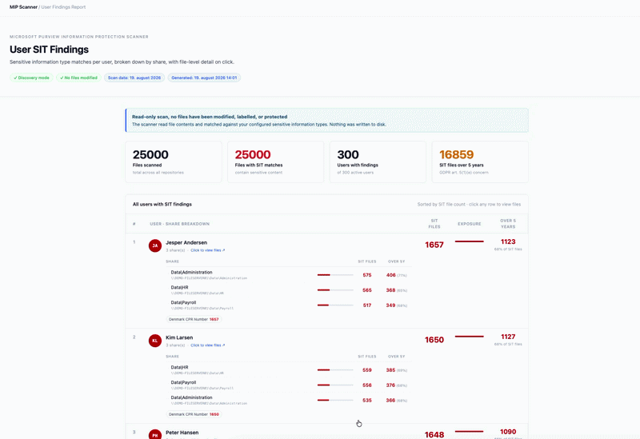

# MIP Scanner Report

**The Microsoft Purview Information Protection Scanner finds your sensitive data — and then hands you a raw CSV nobody can read.** This script turns that `DetailedReport` CSV into a single, self-contained HTML report you can actually hand to a customer: one row per user, a share-by-share breakdown of what was found, and a click-to-browse file list.

No portal, no database, no upload. You run one PowerShell command and get one `.html` file.



## Why

After a scan, the Information Protection Scanner writes a `DetailedReport_*.csv` with a row per file and per Sensitive Information Type (SIT) match. On a real file share that's tens of thousands of rows — useful to a machine, useless to a human. Everyone ends up building the same pivot table by hand before they can tell a customer *who* is sitting on *what*. This does that step for you, the same way every time.

## What you get

- **100% client-side** — the report is a single HTML file; no data leaves the machine that opens it
- **Read-only** — no files are modified, labelled, or protected; this only *reports*
- **Per-user breakdown by share**, with SIT type counts
- **Stale-data flag** — highlights files with sensitive content **not modified in over 5 years** (a GDPR art. 5(1)(e) storage-limitation risk)
- **Drill-down** — click any user row to browse their individual files, filter, and export to CSV

## Requirements

- Windows PowerShell 5.1+ (or PowerShell 7+)
- A `DetailedReport_*.csv` produced by the MIP Scanner
  (default location: `C:\Users\svc-mipscanner\AppData\Local\Microsoft\MSIP\Scanner\Reports`)

## Usage

```powershell
.\MIPUserReport.ps1 -Organisation "Contoso A/S" -CsvPath "C:\Reports\DetailedReport_2026-08-19.csv"
```

| Parameter         | Required    | Description |
|-------------------|:-----------:|-------------|
| `-Organisation`   | Recommended | Customer/company name shown in the report title and header |
| `-CsvPath`        | No | Path to the scanner's `DetailedReport_*.csv`. If omitted, the newest one is auto-detected |
| `-ServiceAccount` | No | If you're not running as the scanner's service account, set this to its username (e.g. `svc-mipscanner`) so the script reads that profile's report folder |
| `-OutputPath`     | No | Where to save the generated `.html` report. Defaults to the same folder as the CSV |
| `-OpenInBrowser`  | No | Switch — opens the finished report automatically |

### Examples

Let the script find the newest CSV and open the report when done:

```powershell
.\MIPUserReport.ps1 -Organisation "Contoso A/S" -OpenInBrowser
```

Run as your own account but read the service account's reports:

```powershell
.\MIPUserReport.ps1 -Organisation "Contoso A/S" -ServiceAccount "svc-mipscanner"
```

## Output

A single `.html` file containing:

- **KPI summary** — files scanned, files with SIT matches, users with findings, files over 5 years old
- **A sortable table** of every user with findings, broken down by share
- **A per-user drill-down** (click any row) listing every matching file, with search/filter and CSV export

## Deploying the scanner itself

This tool reports on a scanner that's already running. If you're still setting the scanner up, I've written two field guides that cover the parts the docs don't:

- [Getting started with the Information Protection Scanner](https://mathiasbaden.com/posts/information-protection-scanner-setup.html) — authentication, SQL, scan jobs, and the silent-failure pitfalls
- [Applying labels with the scanner](https://mathiasbaden.com/posts/information-protection-scanner-labeling.html) — moving from discovery to enforcement

## License

MIT License — Copyright (c) 2026 Mathias Baden Frederiksen — [mathiasbaden.com](https://mathiasbaden.com)

---

⭐ If this saved you an afternoon of Excel, a star helps others find it.
